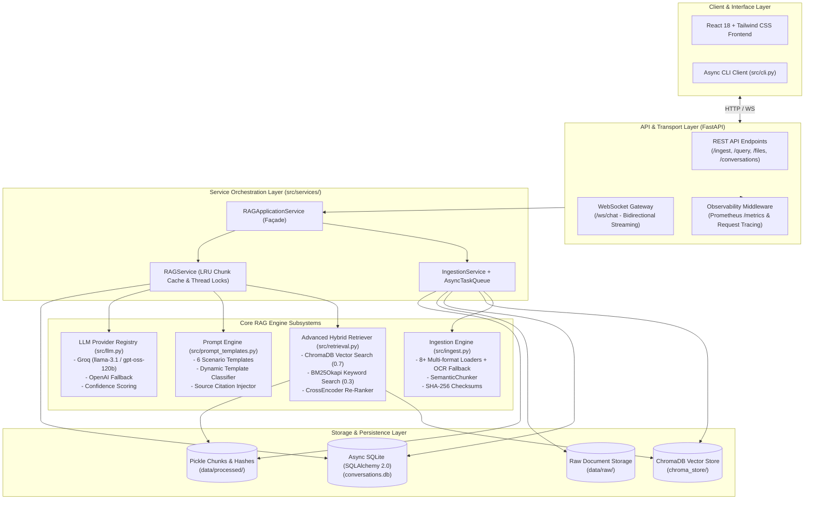
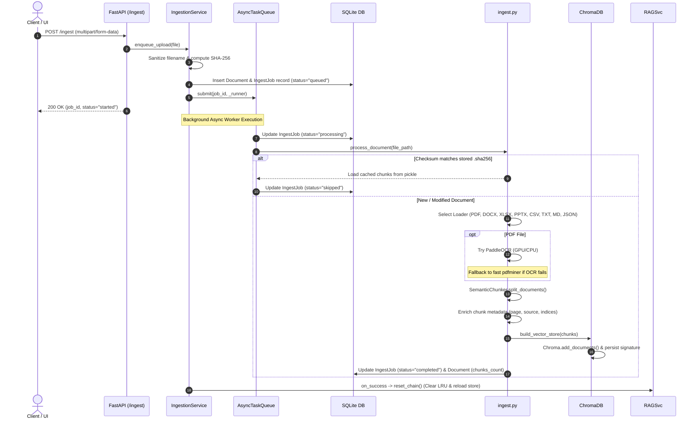
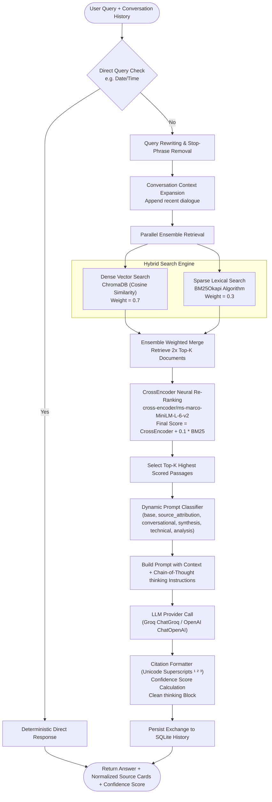

# Enterprise RAG Service: Technical Architecture & FAANG Interview Preparation Guide

---

## Part 1: Service Technical Architecture & Workflows

### 1.1 Architecture Overview

The **Enterprise RAG Service** is a high-performance, asynchronous Retrieval-Augmented Generation (RAG) platform designed for document intelligence, hybrid information retrieval, and real-time streaming generation.



---

### 1.2 End-to-End Ingestion Lifecycle



---

### 1.3 Query Retrieval & Generation Pipeline



---

## Part 2: FAANG Interview Questions & Detailed Technical Solutions

### Section 1: System Design & Distributed Architecture

#### Q1. How would you scale this RAG service from a single node to handle 10,000 QPS and 100 million documents?

**Ideal Answer Structure:**
1. **Decouple Ingestion from Retrieval**:
   - In the current single-instance design, `AsyncTaskQueue` runs in-memory. At FAANG scale, replace in-memory tasks with a distributed message bus (**Apache Kafka** or **RabbitMQ**) paired with **Celery / Temporal** worker clusters.
   - Separate compute clusters: Dedicated GPU nodes for OCR and Embedding extraction, stateless CPU worker nodes for text chunking and metadata enrichment.
2. **Distributed Vector Database (ChromaDB $\rightarrow$ Distributed ANN)**:
   - Single-node ChromaDB cannot hold 100M document vectors in RAM.
   - Migrate to distributed vector search engines like **Milvus**, **Qdrant**, or **Pinecone** with **HNSW (Hierarchical Navigable Small World)** or **IVF-PQ (Inverted File Product Quantization)** indexes partitioned by document collection, tenant ID, or hash ranges.
   - Add **Read Replicas** for vector search with a load balancer to distribute retrieval load across nodes.
3. **Multi-Tier Caching Strategy**:
   - **L1 (Exact Query Cache)**: In-memory Redis cache with TTL for identical query hashes $\rightarrow$ sub-millisecond response.
   - **L2 (Semantic Embedding Cache)**: Cache query embeddings in Redis to avoid re-running HuggingFace/OpenAI embedding models for semantic cache matches (cosine similarity $> 0.96$).
   - **L3 (Document Chunk Cache)**: Replace the local Python LRU cache (`_chunk_cache`) with a distributed Redis Cluster or Memcached for BM25 raw text lookups.
4. **LLM Gateway & Asynchronous Streaming**:
   - Use an LLM proxy layer with multi-model fallback, rate limiting, and token bucket algorithms across providers (Groq $\rightarrow$ Anthropic $\rightarrow$ OpenAI $\rightarrow$ Self-hosted vLLM on AWS/GCP).
   - Use **Server-Sent Events (SSE)** or **gRPC streaming** behind an API Gateway (Envoy/Kong) to manage connection backpressure.

---

#### Q2. Why did you choose WebSockets for chat rather than Server-Sent Events (SSE) or Long Polling? What are the trade-offs?

**Deep-Dive Answer:**
- **Why WebSockets:**
  1. **Full-Duplex Bidirectional Communication**: The client can send control frames over the exact same channel without initiating new HTTP handshakes. Specifically, our implementation supports `stop_generation` (instant cancellation of running LLM inference tasks) and client `ping/pong` heartbeats.
  2. **Lower Frame Overhead**: Once the initial HTTP upgrade handshake completes, WebSocket frames have minimal framing overhead (2–10 bytes), whereas HTTP requests include complete headers with every payload.
- **Trade-Offs & Edge Cases:**
  1. **Load Balancing Complexity**: WebSockets are stateful, long-lived TCP connections. Traditional Layer-7 round-robin HTTP load balancers can cause uneven connection distribution. Requires sticky sessions or connection hashing.
  2. **Reconnection & Replay**: Unlike SSE (which includes native `Last-Event-ID` auto-reconnect logic), WebSockets require custom application-level heartbeat detection and reconnection retry loops.
  3. **Corporate Firewalls & Proxies**: Some enterprise proxies terminate or buffer long-lived WebSockets; SSE works over standard HTTP/1.1 or HTTP/2.

---

#### Q3. How does the service ensure idempotency and prevent duplicate data ingestion under network retries?

**Deep-Dive Answer:**
- **SHA-256 Checksum Validation**:
  - When a file is uploaded, the service immediately computes its SHA-256 hash before disk write or chunking.
  - The hash is compared against existing checksums stored in `data/processed/checksums/<basename>.sha256` and the SQLite `documents.checksum` index.
  - If the hash matches an existing processed document, the ingest process skips expensive OCR, chunking, and embedding generation, marking the job status as `skipped`.
- **Unique Job ID & State Machine**:
  - Each upload generates a unique UUID `job_id`.
  - The job transitions through deterministic states: `queued` $\rightarrow$ `processing` $\rightarrow$ `completed` / `failed` / `skipped`.
  - Duplicate upload attempts return the existing document record or overwrite only when content differences are detected.

---

### Section 2: Machine Learning, Information Retrieval (IR) & NLP

#### Q4. Why use Hybrid Retrieval (Dense Vector + Sparse BM25) instead of pure Dense Vector search?

**Deep-Dive Answer:**
- **The Shortcoming of Pure Dense Search (Embedding Blindspots)**:
  - Dense embeddings (e.g., `BAAI/bge-base-en-v1.5`) excel at semantic concepts (e.g., matching *"feline medical issues"* with *"cat illnesses"*).
  - However, dense models struggle with **exact keywords, alphanumeric IDs, domain-specific abbreviations, and rare acronyms** (e.g., product SKUs, error codes like `ERR-502-BAD-GATEWAY`, or exact legal citations).
- **The Role of BM25 (Sparse Lexical Search)**:
  - BM25Okapi uses Term Frequency-Inverse Document Frequency (TF-IDF) principles, providing exact lexical token matching regardless of embedding training distributions.
- **Our Ensemble Architecture**:
  - We use an `EnsembleRetriever` with weighted reciprocal scoring:
    $$\text{Score}_{\text{hybrid}} = 0.7 \times \text{Score}_{\text{dense}} + 0.3 \times \text{Score}_{\text{BM25}}$$
  - If BM25 is unavailable (e.g., empty corpus initialization), the system gracefully degrades to vector-only search without throwing uncaught exceptions.

---

#### Q5. Explain Cross-Encoder Re-ranking vs. Bi-Encoder Retrieval. Why not use Cross-Encoder for the entire search?

```
Bi-Encoder (Fast, O(1) Index Lookup):
Query    ──► [Embedding Model] ──► Query Vector  ──┐ Cosine
Document ──► [Embedding Model] ──► Doc Vector    ──┴──► Similarity Score

Cross-Encoder (High Accuracy, O(N) Heavy Computation):
[Query + Document Text] ──► [Full Self-Attention Transformer] ──► Relevance Score (0 to 1)
```

**Deep-Dive Answer:**
- **Bi-Encoder (Retrieval Stage)**:
  - Computes query and document embeddings independently.
  - Documents can be pre-computed and stored in ChromaDB offline.
  - At runtime, finding the nearest neighbors takes milliseconds using approximate nearest neighbors (ANN).
  - *Limitation*: No token-to-token cross-attention between query words and document words.
- **Cross-Encoder (Re-ranking Stage)**:
  - Feeds the query and document *together* into a single transformer (`cross-encoder/ms-marco-MiniLM-L-6-v2`).
  - Allows all tokens of the query to attend to all tokens of the document across all layers.
  - *Limitation*: Requires running full forward passes on every candidate at query time. Evaluating 100,000 documents this way would take tens of seconds.
- **Two-Stage Pipeline Solution**:
  1. Retrieve Top-$2K$ candidates fast using Bi-Encoder + BM25 ensemble ($K=5 \implies 10$ candidates).
  2. Run Cross-Encoder re-ranking only on those 10 candidates.
  3. Re-sort by $\text{CrossEncoder Score} + 0.1 \times \text{BM25 Score}$ and select final Top-$K$.

---

#### Q6. What is Semantic Chunking, and how does it compare to Fixed-Size Chunking with Overlap?

**Deep-Dive Answer:**
- **Fixed-Size Chunking (Character / Token Count with Overlap)**:
  - Chunks text every $N$ characters (e.g., 1000 tokens with 150 token overlap).
  - *Problem*: Splitting at arbitrary character thresholds often cuts sentences, code blocks, or logical arguments in half, damaging the embedding vector's contextual integrity.
- **Semantic Chunking ([`SemanticChunker`](file:///c:/Users/anike/PycharmProjects/rag_llm/src/ingest.py#L349))**:
  - Splits text into individual sentences and computes sequential embedding vectors.
  - Measures the cosine distance between consecutive sentence embeddings.
  - When the distance between sentence $i$ and sentence $i+1$ exceeds a statistical threshold (e.g., 95th percentile shift), it indicates a shift in topic or semantic intent $\rightarrow$ a chunk boundary is placed.
  - *Benefit*: Each chunk represents a coherent, complete idea or topic, significantly improving retrieval precision.

---

#### Q7. How does the system detect and mitigate LLM Hallucinations?

**Deep-Dive Answer:**
1. **Strict Chain-of-Thought `<thinking>` Grounding**:
   - System prompts enforce that the LLM must first analyze the `<CONTEXT_START>...<CONTEXT_END>` extracts step-by-step in a `<thinking>` block before emitting the final summary and bullet points.
   - If the answer is not supported by context, the model is strictly constrained to output: *"The information is not provided in the context."*
2. **Dynamic Confidence Scoring Algorithm ([`_calculate_confidence_score`](file:///c:/Users/anike/PycharmProjects/rag_llm/src/llm.py#L383))**:
   - **Lexical Overlap & Keyword Density**: Evaluates n-gram word overlaps between generated answer tokens and retrieved source document chunks.
   - **Hedge Word Penalties**: Detects uncertainty phrases (*"might be", "possibly", "unclear", "could mean"*) and penalizes the confidence score.
   - **Cross-Encoder Score Weighting**: Incorporates the retrieval re-ranker's score into the final confidence metric.
3. **Traceable Superscript Citations**:
   - The system replaces generic citations with normalized unicode superscripts ($^1, ^2, ^3$) mapped directly to the original file path, page number, and text snippet.

---

### Section 3: Concurrency, Database & Backend Engineering

#### Q8. Explain how the service prevents Race Conditions and Deadlocks during vector store reloads and chunk caching.

**Deep-Dive Answer:**
- **Double-Checked Locking in `RAGService`**:
  ```python
  def _ensure_chain(self):
      chain = self._enhanced_chain
      if chain is not None:
          return chain  # Fast path without acquiring lock

      with self._chain_lock:
          if self._enhanced_chain is not None:
              return self._enhanced_chain  # Re-check inside critical section
          # Initialize vector store & chain safely
  ```
  - Prevents multiple concurrent asyncio/executor threads from re-initializing heavy ChromaDB connections or parsing chunk pickle files simultaneously.
- **LRU Cache Thread Safety**:
  - `_chunk_cache` utilizes an `OrderedDict` bounded by `_MAX_CHUNK_FILES = 48`.
  - Cache access and evictions are protected by `_cache_lock` to ensure atomic updates under asynchronous query loads.
- **Non-blocking Event Loop via `run_in_executor`**:
  - Blocking CPU-bound tasks (e.g., CrossEncoder inference, ChromaDB SQLite I/O, pickle loading) are dispatched to `loop.run_in_executor(None, ...)` so the main FastAPI asyncio event loop is never blocked from serving real-time WebSocket heartbeats.

---

#### Q9. How are schema migrations and database sessions managed in the Async SQLAlchemy layer?

**Deep-Dive Answer:**
- **Async Engine & Context Managers**:
  - Uses `create_async_engine(DATABASE_URL)` with `async_sessionmaker(expire_on_commit=False)`.
  - Session lifecycle is encapsulated in an `@asynccontextmanager` (`get_session()`) that automatically handles transaction commits and rollbacks on exceptions:
    ```python
    async with get_session() as session:
        repo = ConversationRepository(session)
        await repo.create(...)
    ```
- **Repository Pattern**:
  - Decouples raw SQL queries and ORM operations into dedicated repositories (`ConversationRepository`, `DocumentRepository`, `JobRepository`).
  - Serializes JSON payloads (such as conversation message arrays) cleanly into SQLite Text columns for flexible document history without complex joins.

---

### Section 4: Production Observability & Reliability

#### Q10. What metrics would you monitor in production to diagnose RAG performance degradation?

**Deep-Dive Answer:**

| Metric Name | Type | Target Threshold | What It Detects |
| :--- | :--- | :--- | :--- |
| `rag_http_request_duration_seconds` | Histogram | p95 $< 1.5\text{s}$ | Overall user-facing latency spikes |
| `rag_retrieval_duration_seconds` | Histogram | p95 $< 250\text{ms}$ | Vector DB index degradation or slow disk I/O |
| `rag_generation_duration_seconds` | Histogram | p95 $< 1.2\text{s}$ | LLM provider (Groq/OpenAI) rate limits or latency degradation |
| `rag_generation_tokens_total` | Counter | Monitored | Token burn rate and unexpected prompt bloat |
| `rag_pipeline_errors_total` | Counter | 0 per min | Component failures (e.g., OCR crash, vector store lock failure) |
| `rag_retrieved_documents_count` | Histogram | Average 5 | Low retrieval recall indicating poor chunking or query mismatch |

---

### Section 5: Behavioral & Engineering Leadership Questions

#### Q11. "Describe a scenario where a third-party dependency broke your pipeline and how you architected around it."

**Talking Point for this Project:**
> *"When integrating OCR extraction for PDF files using PaddleOCR and Unstructured, we encountered low-level Windows DLL conflicts (`WinError 127`) and OneDNN acceleration errors with fused convolution operations on specific CPU/GPU configurations. Rather than allowing the entire ingestion process to fail, I architected a robust two-tier fallback pipeline in `src/ingest.py`:
> 1. We monkey-patched language code parameters and safely configured environment flags (`FLAGS_use_onednn=0`).
> 2. We wrapped extraction in a resilient loader (`_RobustPDFLoader`) that catches OCR exceptions and automatically falls back to `strategy='fast'` using `pdfminer`.
> 3. This guaranteed that users could always ingest and query their documents even if optical OCR engines failed."*

---

#### Q12. "How do you evaluate and test the quality of this RAG pipeline continuously?"

**Talking Point:**
> *"We implement a multi-layered testing and evaluation framework:
> 1. **Unit & Mock Testing (`pytest`)**: Uses synthetic document fixtures and `FakeEmbeddings` to test ingestion, re-ranking, and conversation repositories in isolated temporary environments without mutating production ChromaDB collections.
> 2. **Triad Quality Metrics (RAGAS / TruLens framework)**:
>    - **Context Relevance**: Did the hybrid retriever return documents pertinent to the question?
>    - **Groundedness**: Is every sentence in the LLM's generated response directly traceable to a retrieved chunk?
>    - **Answer Relevance**: Does the final answer directly address the user's prompt without unnecessary drift?
> 3. **Startup Health Verification**: Automated LLM health check on application boot (`run_llm_health_check()`) and async RAG chain pre-warming during FastAPI lifespan initialization."*
